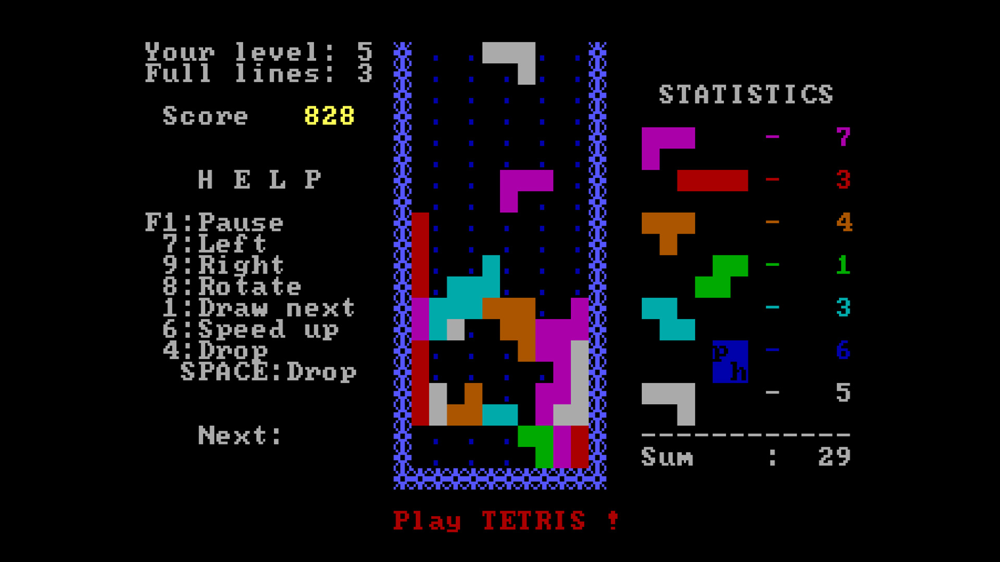

# Tetris for the LandTiger LPC1768

This project was developed for the **Computer Architectures** course at **Politecnico di Torino**.

It implements a version of Tetris for the **LandTiger** board, based on the **NXP LPC1768** microcontroller. The game is displayed on the LCD and controlled using the board’s joystick and buttons.

## Features

- Move pieces left and right
- Rotate pieces
- Speed up or instantly drop a piece
- Clear completed lines
- Display the score, high score, and number of cleared lines
- Pause, resume, and restart the game

## Controls

| Control | Action |
| ------- | ------ |
| Joystick up | Rotate the piece |
| Joystick down | Speed up the piece’s fall |
| Joystick left/right | Move the piece |
| KEY1 | Start, pause, or resume the game |
| KEY2 | Drop the piece instantly |

## Project structure

- `Source/sample.c`: initializes the board and starts the game
- `Source/game.c`, `Source/game.h`: game logic and graphical interface
- `Source/GLCD/`: LCD display support
- `Source/joystick/`: joystick initialization and input handling
- `Source/button_EXINT/`: button handling via interrupts
- `Source/RIT/`: periodic input handling using the Repetitive Interrupt Timer
- `Source/timer/`: timer support and piece fall updates
- `Source/system_LPC17xx.c`, `Source/startup_LPC17xx.s`: microcontroller initialization and startup
- `sample.uvprojx`: Keil µVision project file

## Build and run

1. Open `sample.uvprojx` with **Keil µVision**.
2. If prompted, install the **NXP LPC1700** Device Family Pack.
3. Select the desired target, such as `LandTiger_LPC1768 (release)` or `SW_DEBUG`.
4. Build the project and flash the firmware to the LandTiger LPC1768 board.

The `SW_DEBUG` target defines `SIMULATOR` and is configured for use with the software simulator included in the project. Running the game with physical peripherals requires a LandTiger LPC1768 board.

## Notes

The `*.uvguix.*` files and `sample.uvoptx` contain local Keil settings, such as the IDE layout and project options; they are not part of the game logic.
